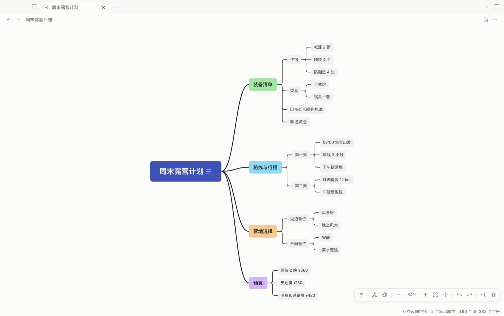

# Mind Map for Obsidian

XMind 风格的思维导图插件。Markdown 是唯一数据源：标题和列表就是节点，脑图视图只是同一个 `.md`
文件的另一种编辑器，改哪边另一边都跟着变。零运行时依赖，桌面端和移动端都能用。



## 用法

1. 命令面板 → **新建思维导图**，或者给任意笔记的 frontmatter 加上 `mindmap: true`。
2. 带这个键的笔记默认以脑图打开；视图右上角的按钮、命令 **在思维导图和 Markdown 之间切换**、
   文件右键菜单都能来回切。
3. 普通笔记里写一个 ```` ```mindmap ```` 代码块，块内写同样的 Markdown，阅读模式和实时预览都会渲染成一张小图。
   默认只读；点工具栏的铅笔或双击节点进入编辑，改动直接写回这个代码块，撤销重做也只作用于块内。
4. 把 `.xmind` 文件放进 vault 直接打开：只读渲染，多工作表可切换，右上角一键**转换为 Markdown 笔记**。
   XMind Zen / 2020 之后的 content.json 和 XMind 8 的 content.xml 都支持。
5. 视图菜单（右上角 ⋯）或命令面板：**导出为 PNG**、**导出为 SVG**、**复制为图片**。
   PNG 是 2 倍分辨率，Obsidian 自带的 Inter 字体会内嵌，导出和屏幕上看到的一致。

### 编辑

- 单击选中，双击编辑；选中后节点上方出现浮动工具栏：9 种颜色、编辑备注、删除。
- **拖拽节点**到另一个节点上成为它的子节点，拖到子节点列的空隙里则插到那个位置；左右分布时拖到另一侧也行。
- Shift 点击加选，⌘ 点击反选，**Shift 拖拽空白处框选**，⌘A 全选；多选后颜色和删除对整组生效。
- 点节点上的 ≡ 查看备注，工具栏里的备注按钮直接编辑；备注支持 Markdown，写回时保持在节点下方。

### Markdown 映射

```markdown
---
mindmap: true
mindmap-structure: mindmap   # 可选：logic-right（默认）| mindmap
mindmap-theme: rainbow       # 可选：snow（默认）| rainbow
---

# 中心主题                     ← 唯一的一级标题；没有就用文件名

这里的段落是中心主题的备注。

## 主主题 %%green%%            ← %%颜色%% 给节点上色，阅读模式里看不见
### 子主题
- 更深的层级用列表
	- 再深一层
- 折叠状态也存在文件里 %%fold%%
```

- 颜色名：`red orange yellow green teal blue purple pink gray`，或 `#hex`。
- 标题最多到 H6，之后自动改用列表。新建节点默认从第四级开始用列表，可在设置里改。
- 节点下面的段落、代码块原样保留为备注，节点上会显示一个 ≡ 图标，点开查看。
- XMind 导出的 Markdown 就是这套标题层级，可以直接打开；反过来也能被 XMind 导入。

### 快捷键（画布获得焦点时）

| 键 | 作用 |
|---|---|
| Tab | 添加子节点 |
| Enter | 添加兄弟节点（根节点上是添加子节点）；Shift+Enter 插到前面 |
| 双击 / 空格 / F2 | 编辑；Enter 提交，Esc 取消 |
| Delete / Backspace | 删除选中的节点及其子树 |
| Shift+点击 / ⌘+点击 / Shift+拖拽 / ⌘A | 加选 / 反选 / 框选 / 全选 |
| 拖拽节点 | 换父节点或调整顺序 |
| / | 折叠、展开 |
| 方向键 | 在节点间移动 |
| ⌘Z / ⌘⇧Z | 撤销 / 重做 |
| 滚轮 / 拖拽空白处 | 平移 |
| ⌘+滚轮 / 双指捏合 / ⌘= ⌘- | 缩放；⌘0 适应画布 |

## 开发

```bash
pnpm install
pnpm test            # Markdown 往返与布局的单元测试
pnpm typecheck
pnpm build           # 产物在 dist/main.js
pnpm install-vault   # 复制到 JackWei vault（OBSIDIAN_VAULT=... 可覆盖）
pnpm harness         # 监听构建 dev/harness.js，然后用任意静态服务器打开 dev/index.html
```

`dev/index.html` 是脱离 Obsidian 的调试页，能切主题、结构、深色模式，并实时打印写回的 Markdown。

### 结构

| 文件 | 职责 |
|---|---|
| `src/markdown.ts` | Markdown ⇄ 树，往返无损 |
| `src/model.ts` | 树模型与增删移操作 |
| `src/layout.ts` | 布局引擎（逻辑图 / 左右分布）与连线几何 |
| `src/canvas.ts` | 渲染、平移缩放、选择、内联编辑、键盘 |
| `src/view.ts` | Obsidian 的 TextFileView，负责读写文件与撤销栈 |
| `src/main.ts` | 视图注册与重定向、命令、代码块（含写回）、菜单 |
| `src/codeblock.ts` | 在宿主笔记里定位并替换 mindmap 代码块 |
| `src/export.ts` | SVG / PNG 导出，内嵌字体 |
| `src/xmind.ts` | .xmind 读取（自带 zip 与 XML 解析）→ Markdown |
| `src/xmind-view.ts` | .xmind 只读视图与转换 |
| `styles.css` | 主题变量，跟随 Obsidian 明暗模式 |

## 发布

推 tag 即发布：`git tag v0.2.0 && git push --tags`，GitHub Actions 会构建并把 `main.js`、`manifest.json`、`styles.css`
挂到 Release。用 BRAT 的人填仓库地址就能装；手动安装把这三个文件放进
`<vault>/.obsidian/plugins/obsidian-mindmap/`。运行时不需要 Node。

## 许可

MIT
